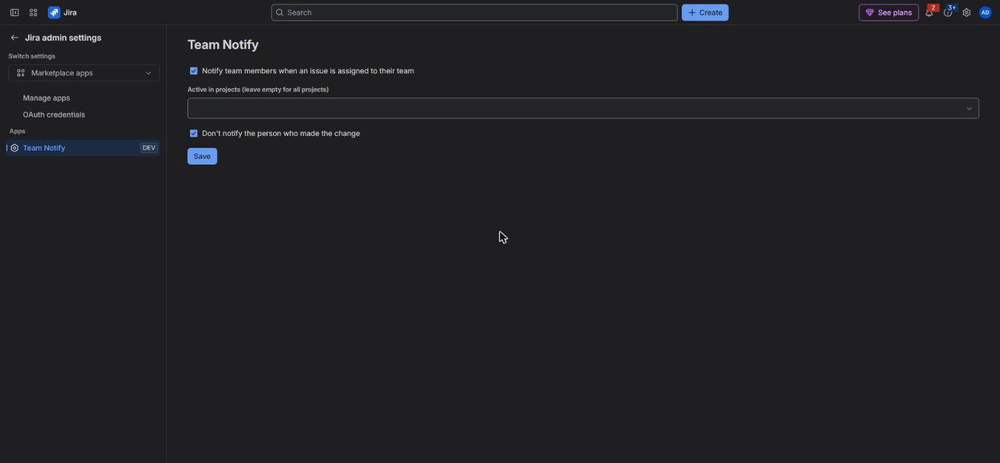
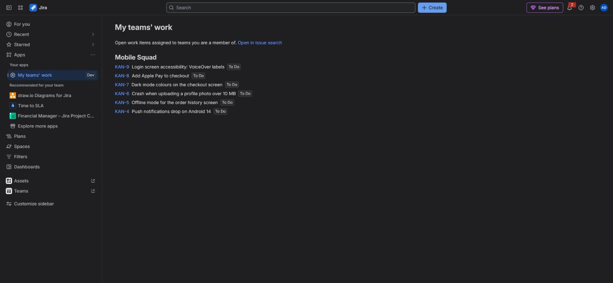

# Team Notify for Jira

When a Jira work item is assigned to an Atlassian Team, Jira notifies nobody. Team Notify emails every member of the
team in the **Team** field the moment it is set or changed, and gives every user one page with the open work of all
their teams.

[Privacy policy](privacy.html) · [Terms of use](terms.html) · [Support](support.html)

## Install
1. In Jira, open **Apps → Explore more apps**, search for **Team Notify** and install it (Jira admin rights needed).
2. That's it: notifications are on for all projects. Settings are optional.

## What team members get
When a work item is created with a team, or its Team field changes to a team, every full member of that team gets an
email from Jira: "Assigned to your team: *team name*", with a link to the work item.

- The person who made the change is not notified (an admin can switch this off).
- Clearing the Team field or editing other fields sends nothing.
- Emails are sent by Jira itself, so people who can't browse the work item get nothing, and Jira's own email
  preferences apply.

## Settings (Jira admins)
**Jira settings → Apps → Team Notify**

- **Notify team members when an issue is assigned to their team** — turns the app on or off.
- **Active in projects** — leave empty for all projects (new projects are included automatically), or pick some.
- **Don't notify the person who made the change** — on by default.

## My teams' work (every user)
**Apps → My teams' work** lists the open work items of every team you are a member of, grouped by team. "Open in issue
search" opens the same list in Jira's search, where you can filter, sort and save it.

The page shows the 100 most recently updated items; the issue search shows all of them.

## Questions
See [Support](support.html).
